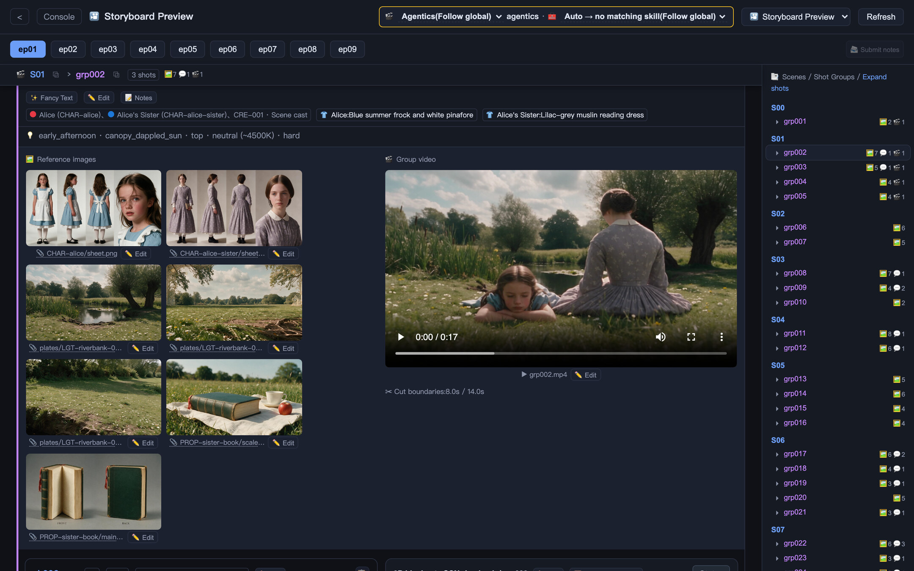
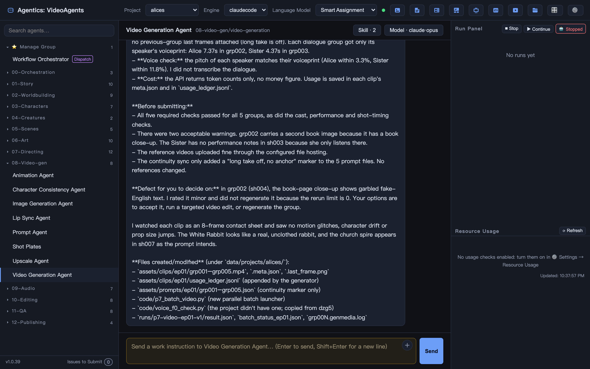
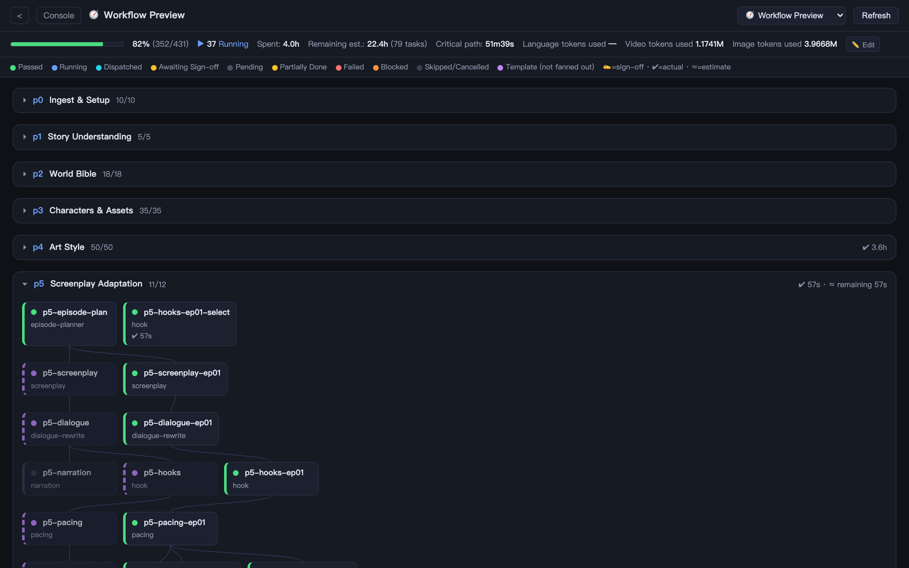
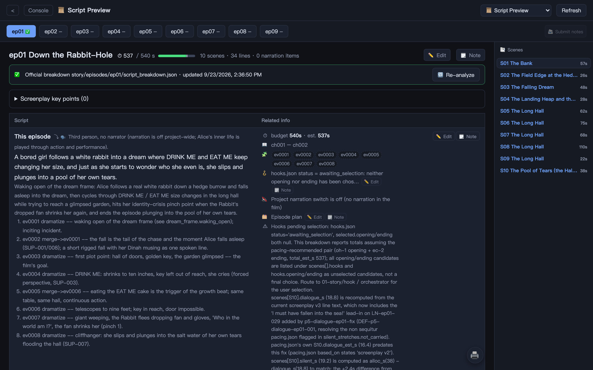
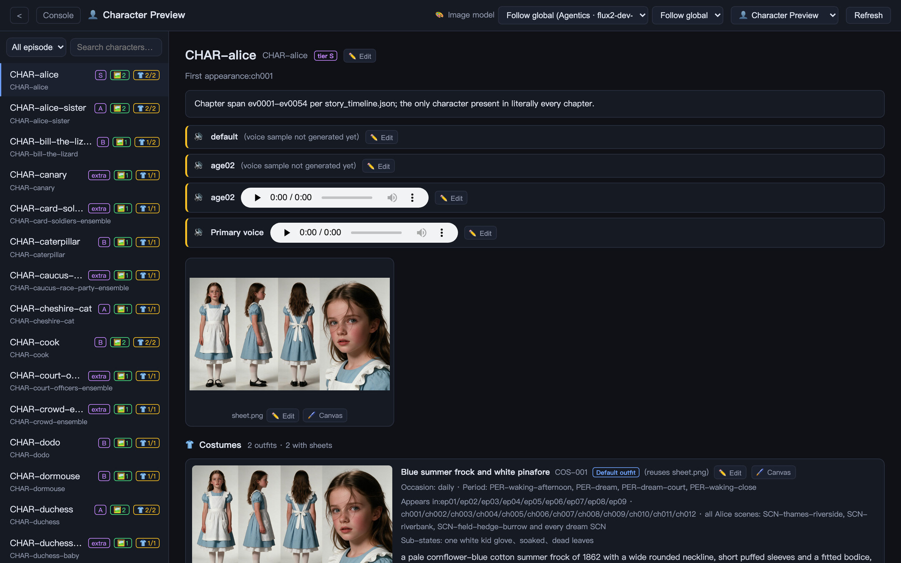
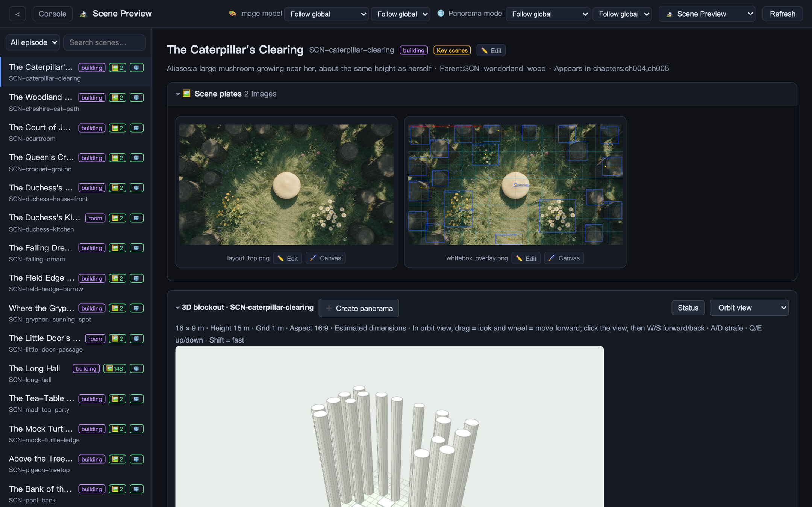
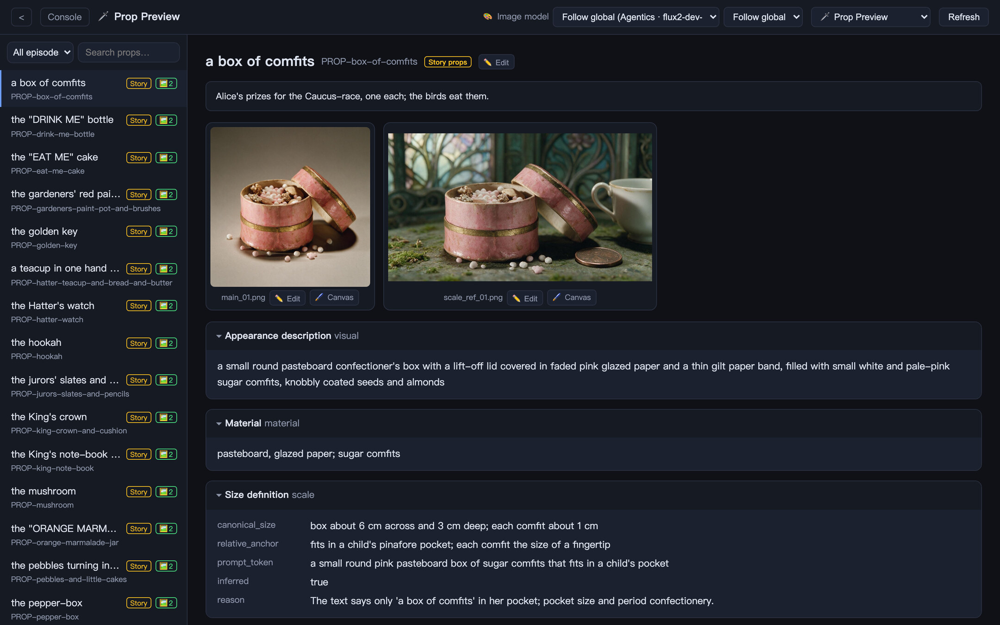
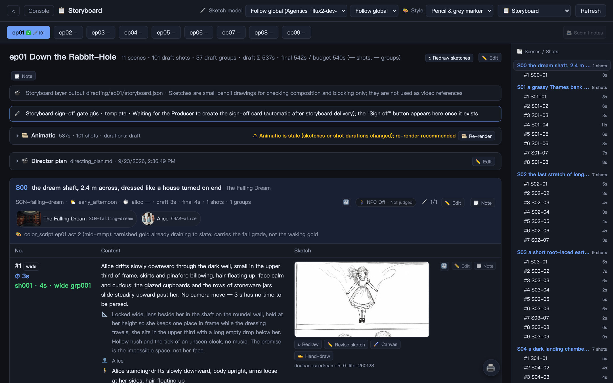
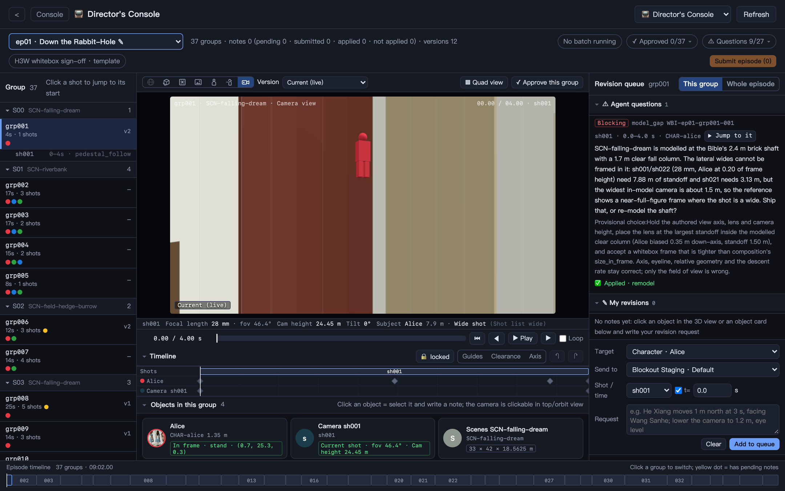
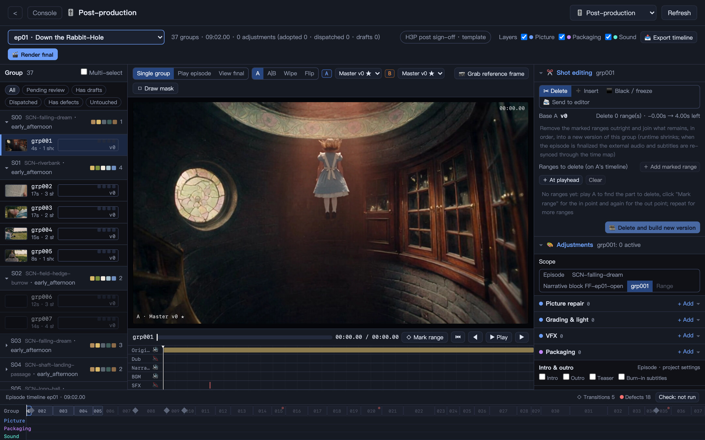

<p align="center">
  
</p>

<h1 align="center">Agentics WorldOS</h1>

<p align="center">
  <strong>Build a virtual world first, then create inside it — episodic video today, with novels, audio, games and VR growing out of the same world.</strong>
</p>

<p align="center">
  <sub>This repository is <strong>VideoAgents</strong>; its web console and agentics.world desktop build are titled Agentics WorldOS. The app, download packages and commands still use the VideoAgents name.</sub>
</p>

<p align="center">
  <a href="#quickstart"><strong>Quickstart</strong></a> &middot;
  <a href="#works-with"><strong>Works with</strong></a> &middot;
  <a href="https://github.com/AgenticsWorld/VideoAgents-Samples"><strong>Samples</strong></a> &middot;
  <a href="https://discord.gg/faaZCrWxCq"><strong>Discord</strong></a> &middot;
  <a href="https://x.com/AgenticsWorld"><strong>X</strong></a> &middot;
  <a href="https://agentics.world"><strong>Website</strong></a> &middot;
  <a href="README.zh-CN.md"><strong>中文</strong></a>
</p>

<p align="center">
  <a href="LICENSE"></a>
  <a href="https://github.com/AgenticsWorld/VideoAgents/releases"></a>
  <a href="https://github.com/AgenticsWorld/VideoAgents/stargazers"></a>
  <a href="https://discord.gg/faaZCrWxCq"></a>
</p>

<br/>

<p align="center">
  <a href="docs/assets/readme/storyboard-preview.jpg"></a>
</p>

<p align="center">
  <sub>Storyboard Preview in the <a href="https://github.com/AgenticsWorld/VideoAgents-Samples">alices</a> sample project (<em>Alice's Adventures in Wonderland</em>): the character sheets, plates and props a generation group is anchored to, and the video it produced.</sub>
</p>

<br/>

## 30-second tour

<div align="center">
  <video src="https://github.com/user-attachments/assets/97e159f0-8c10-46c2-98d7-915e62d1d749" width="900" controls></video>
</div>

<br/>

# Build the world once. Create inside it as often as you like.

Most AI tools start every piece from a blank prompt. Each shot, chapter or clip re-invents the people and places in it, so a cup changes colour between two shots, a face drifts between episodes, and a spin-off starts again from zero.

Agentics WorldOS turns this around. It is an open-source, file-based multi-agent system that first builds a **virtual world** — its history and rules, its people and their voices, its creatures, places and props, the look of its art — and keeps that world on your machine as files. Everything you make afterwards is made *inside* that world: every episode, chapter and soundtrack draws on the same canon, the same reference sheets and the same 3D sets, so it stays consistent, and each new work reuses what the world already has instead of paying to make it again.

**If a video model is a _camera_, Agentics WorldOS is the _world_ in front of it — and the studio around it.**

### Two layers: the world, and the works made in it

Each project is one world.

|                    | What lives there                                                                                                                                                                                                   | In the project folder                   |
| ------------------ | ------------------------------------------------------------------------------------------------------------------------------------------------------------------------------------------------------------------ | --------------------------------------- |
| 🌍 **The world**   | A world bible (timeline, events, rules, factions) · characters with reference sheets, costumes and voices · creatures · scenes with top-down layouts, 3D sets, 360° panoramas and walkable world models · props with material and size · one art style · a music library | `bible/`, `assets/`: one anchor per thing, shared by every work |
| 🎬 **The works**   | Episodes and other pieces made from the world, each with its own script, storyboard, previs, generation records, edit and release package                                                                          | `story/`, `directing/`, `edit/`, `publish/` |

You sign off the world before anything expensive is made in it. From then on the agents treat it as fact, and a world-consistency reviewer checks the works against it.

### What you can make from a world

|     | Work                         | Status                          | How                                                                                                                                                         |
| --- | ---------------------------- | ------------------------------- | ----------------------------------------------------------------------------------------------------------------------------------------------------------- |
| 🎬  | **Film & series**            | ✅ Built in (default type)       | Adapt the source novel episode by episode, or ask for original stories that borrow only the world (derivative mode).                    |
| 📚  | **Novels**                   | 🧩 Plugin, ships in this repo    | `derivative-fiction` writes prequels, side stories and what-ifs inside the canon; `fusion-fiction` moves one book's story into another book's world.       |
| 🎧  | **Audio drama**              | 🧩 Plugin                        | An audio-drama team in [VideoAgents-Plugins](https://github.com/AgenticsWorld/VideoAgents-Plugins).                                                         |
| 🎮  | **Games**                    | 🧭 On the roadmap                | The world already holds what a game needs to start from: metric-scale 3D sets, world models with a collision mesh, character sheets, voices, music and sound. |
| 🥽  | **VR**                       | 🧭 On the roadmap                | The world already holds 360° panoramas of each scene's key positions and Gaussian-splat world models you can walk through in the browser.                   |

Four lighter project types skip most of the world layer when you only need a single piece: 🎙️ **audio to video** (generated pictures for a narration recording), 🧑‍💼 **digital human** (portrait photos plus a conversation recording become lip-synced speaker video), ✂️ **mashup** (shots picked from ready-made clips in your local footage library) and 🖥️ **motion graphics** (no video model: agents write the film as code in one of 59 styles — a web page rendered frame by frame, with an original score written in code and procedural sound).

### How it works

|        | Step                  | What happens                                                                                                                                                      |
| ------ | --------------------- | ----------------------------------------------------------------------------------------------------------------------------------------------------------------- |
| **01** | Bring a source        | Create a project, import a novel or manuscript, pick an art style, set the episode length and target platforms.                                                   |
| **02** | Build the world       | World bible → characters, costumes and voices → creatures, scenes and props → 3D sets, panoramas and world models where you want them. You sign off each layer. |
| **03** | Create inside it      | Screenplay → storyboard → 3D whitebox previs → video → sound → edit → post → release. Nothing expensive runs before you approve the step that feeds it.          |
| **04** | Come back to it       | The world stays. Original episodes, a prequel novel, an audio drama: each new work starts from the world you already built, not from a blank prompt.             |

119 specialist agents in 17 departments do the work. Worldbuilding, characters, creatures, scenes and art build the world; story, directing, video generation, audio, editing, QA and publishing create inside it; dedicated audio-to-video, mashup, digital-human and motion-graphics teams handle the lighter formats. They follow a declarative workflow and stop at up to 12 human sign-off gates, so the creative direction stays yours. Everything runs on your machine: the source text, the world and the generated media stay in a local workspace.

<br/>

<a id="works-with"></a>

## Works with

Bring your own engines and providers. Each modality is configured on its own, so you are never locked into one model or vendor.

|                         | Supported                                                                                                                      |
| ----------------------- | ------------------------------------------------------------------------------------------------------------------------------ |
| 🤖 **Agent engines**    | Agentics (built in: bundled Pi running on your Agentics account or a local OpenAI-compatible model) · Claude Code · Codex CLI · Kimi Code · Pi · OpenCode · Grok Build · Antigravity CLI |
| 🖼 **Image**            | Agentics · OpenRouter · Volcano Engine · BytePlus · Fal · RunningHub · ComfyUI                                                  |
| 🎬 **Video**            | Agentics · OpenRouter · Volcano Engine · BytePlus · Fal · RunningHub · ComfyUI                                                  |
| 🎙 **Voice / TTS**      | Agentics · OpenRouter · Volcano Engine · ElevenLabs · MiniMax · ComfyUI                                                         |
| 🎵 **Music**            | Code composition · Agentics · OpenRouter · ElevenLabs · ComfyUI                                                                 |
| 🔊 **Sound effects**    | Code-synthesized · Openverse · ElevenLabs · Fal                                                                                 |
| 🧑 **Digital human**    | Agentics · HeyGen · Kling AI · ComfyUI                                                                                          |
| 🔍 **Upscale**          | FFmpeg · Agentics · Volcano Engine · MiniMax · ComfyUI                                                                          |
| 🌍 **World model**      | World Labs Marble · HunyuanWorld (self-hosted GPU)                                                                              |
| ☁️ **Object storage**   | Volcano Engine TOS · Alibaba Cloud OSS · Tencent Cloud COS · any S3-compatible service                                          |
| 📣 **Publishing**       | YouTube · YouTube Shorts · Bilibili · TikTok · Instagram · Douyin · Xiaohongshu                                                             |
| 📱 **Mobile messaging** | WeChat · Feishu · WhatsApp                                                                                                      |

<sub>ComfyUI workflows run locally, on Comfy Cloud or on RunningHub. The console is available in 12 languages.</sub>

<br/>

## Agentics WorldOS is right for you if

- ✅ You have a **world in a manuscript** — a novel, a web serial, a setting bible — and want it to live on screen and beyond
- ✅ You want **many works from one world**: a series, its spin-offs, a prequel novel, an audio drama, without redesigning the cast every time
- ✅ You want to turn a **novel or web serial into multi-episode video** without assembling a studio
- ✅ You have made one-minute AI shorts and hit the wall at **ten-minute episodes**: props drift, crowded shots fall apart, rerolls eat the budget
- ✅ You want agents to **run the pipeline on their own**, but you still want to approve the creative decisions
- ✅ You want to **choose the model for each job** and switch when a better one ships
- ✅ You want your manuscript, your world and your footage to **stay on your own machine**
- ✅ You want every step to leave a **file you can open, edit and audit**

<br/>

## Features

### 🌍 Build the world

<table>
<tr>
<td align="center" width="33%">
<h3>📖 World Bible</h3>
Break a long novel into events, a timeline and a world bible — rules, places, factions — that every later step treats as fact.
</td>
<td align="center" width="33%">
<h3>🧑‍🎨 Characters & Assets</h3>
Cards, reference sheets and voice samples for characters, costumes, creatures, scenes and props: one anchor per asset for the whole world.
</td>
<td align="center" width="33%">
<h3>🎨 Art Style</h3>
One look for the whole world, picked from a library of more than 1,300 styles or written in your own words.
</td>
</tr>
<tr>
<td align="center">
<h3>🧊 3D Sets</h3>
Optional metric-scale whitebox sets for each scene, with actors, props and cameras on keyframes. The exported camera pass becomes the reference video for generation.
</td>
<td align="center">
<h3>🌐 Panoramas & World Models</h3>
360° panoramas at each scene's key positions, turned into Gaussian-splat worlds (World Labs Marble or self-hosted HunyuanWorld) you can roam with WASD.
</td>
<td align="center">
<h3>🎵 Voices & Music</h3>
Designed or cloned voices for each character and a per-project music library whose themes recur from episode to episode.
</td>
</tr>
</table>

### 🎬 Create inside it

<table>
<tr>
<td align="center" width="33%">
<h3>📜 Script Preview</h3>
The screenplay beside its timing, emotion, pacing and hook analysis. Send a revision note for any block to the agent that owns it.
</td>
<td align="center" width="33%">
<h3>✏️ Storyboard & Animatic</h3>
A shot table with pencil sketches, drawn in bulk with a cheap image model or by hand on your phone, then cut into an animatic with no generation cost.
</td>
<td align="center" width="33%">
<h3>🎥 Director's Console</h3>
Click any actor, prop or camera on the 3D set to leave a note, or drag them yourself. Every change is versioned and comparable A|B.
</td>
</tr>
<tr>
<td align="center">
<h3>🎬 Image & Video Generation</h3>
Prompts are written shot by shot from the shot list, and each generation group carries the sheets, plates and props it must match.
</td>
<td align="center">
<h3>🎙 Dialogue, Music & Sound</h3>
Native dialogue from the video model, the world's voices, cues from the music library, sound effects and the final mix.
</td>
<td align="center">
<h3>🎚 Post-production</h3>
Grading, repair, VFX, packaging and sound as adjustments scoped from a whole episode down to a time range. Masters are never overwritten.
</td>
</tr>
<tr>
<td align="center">
<h3>📚 Novels & Audio Drama</h3>
Plugins write new fiction inside the canon, fuse two books into one world, or turn the story into an audio drama.
</td>
<td align="center">
<h3>🛡 Human Sign-off Gates</h3>
World bible, characters and assets, art style, screenplay, storyboard, whitebox, shot list, video prompts, visuals, post, final cut, release.
</td>
<td align="center">
<h3>✅ Eight QA Reviews</h3>
Logic, character consistency, timeline, world consistency, picture, audio, content safety and copyright are reviewed in parallel.
</td>
</tr>
</table>

### 🧰 Under every world

<table>
<tr>
<td align="center" width="25%">
<h3>💰 Cost Control</h3>
Free previews first, paid steps after sign-off, reuse before regeneration, draft resolution plus upscale, and cheap models for simple jobs: about $3 per finished minute of video.
</td>
<td align="center" width="25%">
<h3>🔌 Plugins & Skills</h3>
Declarative plugins add new roles, workflows and kinds of work. Skills teach one agent one craft. Install either from a zip.
</td>
<td align="center" width="25%">
<h3>🗂 Files, Not a Black Box</h3>
Every card, prompt, shot list and QA report is a file in your project, and each generation records its model, provider and references.
</td>
<td align="center" width="25%">
<h3>🏠 Local First</h3>
Runs on your computer and listens on <code>127.0.0.1</code> by default, with a versioned API, OpenAPI docs and live events for integrations.
</td>
</tr>
</table>

<br/>

## A look inside

<table>
<tr>
<td align="center" width="33%"><a href="docs/assets/readme/console.jpg"></a><br/><sub><strong>Console</strong>: the agent roster, a chat with each agent, and the run panel</sub></td>
<td align="center" width="33%"><a href="docs/assets/readme/workflow.jpg"></a><br/><sub><strong>Workflow</strong>: the pipeline DAG with task states, time and token usage</sub></td>
<td align="center" width="33%"><a href="docs/assets/readme/script.jpg"></a><br/><sub><strong>Script Preview</strong>: screenplay blocks with timing, events and hooks</sub></td>
</tr>
<tr>
<td align="center"><a href="docs/assets/readme/characters.jpg"></a><br/><sub><strong>Characters</strong>: reference sheets, voices and costumes</sub></td>
<td align="center"><a href="docs/assets/readme/scenes.jpg"></a><br/><sub><strong>Scenes</strong>: top-down layouts, plates and the 3D blockout</sub></td>
<td align="center"><a href="docs/assets/readme/props.jpg"></a><br/><sub><strong>Props</strong>: prop cards with material and size definitions</sub></td>
</tr>
<tr>
<td align="center"><a href="docs/assets/readme/storyboard.jpg"></a><br/><sub><strong>Storyboard</strong>: the shot table with pencil sketches and the animatic</sub></td>
<td align="center"><a href="docs/assets/readme/director.jpg"></a><br/><sub><strong>Director's Console</strong>: blocking on the 3D whitebox set</sub></td>
<td align="center"><a href="docs/assets/readme/post.jpg"></a><br/><sub><strong>Post-production</strong>: the A|B monitor, adjustments and the episode timeline</sub></td>
</tr>
</table>

<br/>

## Problems Agentics WorldOS solves

| Without a shared world | With Agentics WorldOS |
| --- | --- |
| ❌ Every new format starts from zero: the adaptation, the spin-off and the audio version each redesign the same people and places. | ✅ One world per project: characters, places, props, voices and style are built once, signed off once, and reused by every work made in it. |
| ❌ The cup is blue porcelain in one shot and white in the next. The lead walks out of a funeral scene in clean everyday clothes. | ✅ A project-wide asset library: prop cards, a costume matrix by occasion and period, and reference sheets that every generation group is anchored to. |
| ❌ Two people in frame are manageable. Add more people and a longer take, and you can no longer tell the model who stands where, looks where and walks where. | ✅ 3D whitebox previs at metric scale: actors, props and cameras are keyframed, reviewed, and exported as a camera pass that is attached to the prompt as a reference video. |
| ❌ Turning "the tension in this scene" into something a model can execute is slow, manual and different every time. | ✅ A prompt agent writes each shot as camera move, action and expression, position, and audio: one camera move per shot, motion described with amount and speed, emotion turned into visible physical detail. |
| ❌ Characters drift from their design, and people who are not in the scene show up in frame. | ✅ New keyframes are compared with the character sheet for face similarity, and prompts carry an identity lock: everyone on screen must match a reference image. |
| ❌ You find out the script or the shot list was wrong after the video has been generated. | ✅ Review moves upstream to the steps that cost nothing: script preview, storyboard sketches and an animatic. A sign-off is marked stale when its upstream changes later. |
| ❌ Most of the budget is burned on footage you never use: rerolls, full-resolution first passes, new reference images for every shot. | ✅ Free previs first, paid steps only after sign-off, reuse before regeneration, draft resolution plus upscale, automatic reruns off by default: about $3 per finished minute. |
| ❌ One flaw in a finished clip means rerolling the whole group. | ✅ A post-production workbench: grading, repair, VFX and sound as versioned adjustments, with A\|B comparison and rollback. |
| ❌ Face swaps bring likeness risk and the same averaged face in every show. | ✅ Characters are original designs generated from the written character settings and the art style, not from photos of real people. |
| ❌ Platform review is strict about details, and a missing license can take a video down. | ✅ A content-safety agent and a copyright agent review each episode before release: shots, thumbnail, subtitles, music and fonts. |
| ❌ Nobody can say how a given version of a character or a shot came about. | ✅ Every step is a file in the project, and each generated asset records the model, provider and references that produced it. |

<br/>

<a id="quickstart"></a>

## Quickstart

Open source. Runs locally. Bring your own engine and provider accounts. The desktop app is still named VideoAgents.

### Install the desktop app

| Platform              | Download                                                                                  |
| --------------------- | ----------------------------------------------------------------------------------------- |
| macOS (Apple silicon) | [VideoAgents.zip](https://s3.agentics.world/packages/video-agents/mac/VideoAgents.zip)    |
| Windows (x64)         | [VideoAgents.zip](https://s3.agentics.world/packages/video-agents/win/VideoAgents.zip)    |

1. **Download, unzip and open the app.** The package does not include Python; on first launch the app downloads its own runtime.
2. **Pick an agent engine in the top bar.** If that CLI is missing or not signed in, a setup dialog installs it with its official script and opens its own login in a terminal.
3. **Add your providers.** In ⚙️ Settings → Generation Models, enter credentials for the image, video and audio services you plan to use.
4. **Create a project — your first world — and import your novel.** The crew starts with the world bible and stops at each sign-off gate for your approval.

FFmpeg is required for media inspection, audio and editing. On Windows the app offers to download it when none is found; on macOS install it with `brew install ffmpeg`.

### Or run from source

Requirements: Python 3.10 or newer, FFmpeg, and at least one agent engine. Node.js 22.12 or newer is needed only for desktop development and packaging.

```bash
git clone https://github.com/AgenticsWorld/VideoAgents.git
cd VideoAgents
python3 -m venv .venv
source .venv/bin/activate
python -m pip install --upgrade pip
python -m pip install -e .
python apps/web/check.py
python apps/web/server.py
```

Open <http://127.0.0.1:8630>. API documentation is at <http://127.0.0.1:8630/api/v1/docs>. After installation the equivalent `videoagents-web` command is also available; use `videoagents-api` when only the API service is needed.

For unattended pipelines, `make run-auto` starts the console in full-auto mode, so agents on the `claude` engine run shell commands without approval prompts. Agents can then execute any command, so use it only on a trusted machine.

Desktop development, packaging, releases and the built-in Agentics engine are covered in [`docs/DEVELOPMENT.md`](docs/DEVELOPMENT.md).

<br/>

## More

- **Plugins** — [VideoAgents-Plugins](https://github.com/AgenticsWorld/VideoAgents-Plugins): add-on agent teams and workflows such as derivative fiction, fusion fiction and audio drama (audio-to-video, mashup and digital human are now built in — pick the project type when creating a project). Install a zip from ⚙️ Settings → Plugins. Uploaded plugins live in the writable runtime data directory.
- **Skills** — [VideoAgents-Skills](https://github.com/AgenticsWorld/VideoAgents-Skills): `SKILL.md` packs that teach one agent one craft. Install a zip from the **Skill** button in the console.
- **Sample projects** — [VideoAgents-Samples](https://github.com/AgenticsWorld/VideoAgents-Samples): complete projects to open and explore, including the _alices_ project shown on this page. Import a project zip with **Import Project…** in the project dropdown.

<br/>

## Under the hood

```text
agents/           Agent role specifications, workflow documentation, and DAG
code/             Repository-level validation and utility scripts
modules/          Media and audio adapters
services/api/     Independently runnable Python API service, schemas, and runtime state
services/runtime/ Agent scheduling, project services, providers, and runtime tools
apps/web/         Original static WebUI plus Python static server/API reverse proxy
apps/desktop/     Electron shell, Python Web lifecycle, packaging, and updates
plugins/          Declarative agent plugins (the derivative-fiction team ships here)
tests/            Regression suite (pytest): modules, pipeline CLIs, and repository integrity
data/projects/    One folder per world: its bible, assets, works, and generated media
```

`agents/WORKFLOW.md` is the human-readable process authority; `agents/workflow.yaml` is the orchestrator's machine-readable input. Browsers and the Electron shell share the same static WebUI, served next to a versioned `/api/v1` with OpenAPI, durable run state and real-time SSE events. See [`docs/ARCHITECTURE.md`](docs/ARCHITECTURE.md) for component relationships and directory decisions.

<br/>

## Configuration and security

Runtime configuration and SQLite control state live in `data/.videoagents/`; project media remains in `data/projects/`. Both can contain private data and are excluded from Git.

Public-release security defaults are deliberately conservative:

- `VIDEOAGENTS_HOST=127.0.0.1`
- `VIDEOAGENTS_PERMISSION_MODE=acceptEdits`
- Claude OAuth usage probing is disabled

See [`.env.example`](.env.example) for opt-in overrides and read [`SECURITY.md`](SECURITY.md) before enabling LAN access or unrestricted agent permissions.

<br/>

## Development

```bash
python -m pip install -e ".[dev]"
pytest
npm run test:web   # Node checks for the browser-side whitebox / director code
```

CI runs the whole `tests/` suite: module and pipeline-CLI regressions, repository integrity (JSON/YAML, workflow agent references, security defaults), and the HTTP layer (route table, offline GET smoke test, Web console pages). Cases that need `ffmpeg` skip when it is not installed.

See [`docs/DEVELOPMENT.md`](docs/DEVELOPMENT.md) for the full development guide and [`CONTRIBUTING.md`](CONTRIBUTING.md) for how to contribute.

<br/>

## Community

- [Discord](https://discord.gg/faaZCrWxCq) — join the community
- [X](https://x.com/AgenticsWorld) — follow updates and announcements
- [GitHub Issues](https://github.com/AgenticsWorld/VideoAgents/issues) — bugs and feature requests

<br/>

## License

Copyright 2026 AgenticsWorld.

Licensed under the [GNU General Public License v3.0](LICENSE) (`GPL-3.0-only`). You may use, modify, and redistribute the project, including commercially. If you distribute the project or a modified version of it, you must license it under the same terms, make the corresponding source code available, keep the license and copyright notices (including [`NOTICE`](NOTICE)) intact, and mark your changes with the date you made them. The software comes with no warranty.

Releases up to and including v1.0.38 were published under the Apache License 2.0 and remain available under those terms.

Citation metadata is available in [`CITATION.cff`](CITATION.cff).

## Trademarks and services

Third-party product and provider names are used only to describe compatible integrations. Their respective owners retain all trademark and service rights. Agentics WorldOS (VideoAgents) does not grant access to or redistribute any third-party model or service.

<br/>

---

<p align="center">
  <sub>Open source under GPL-3.0. Built for people who would rather build worlds and direct what happens in them than babysit the models.</sub>
</p>
