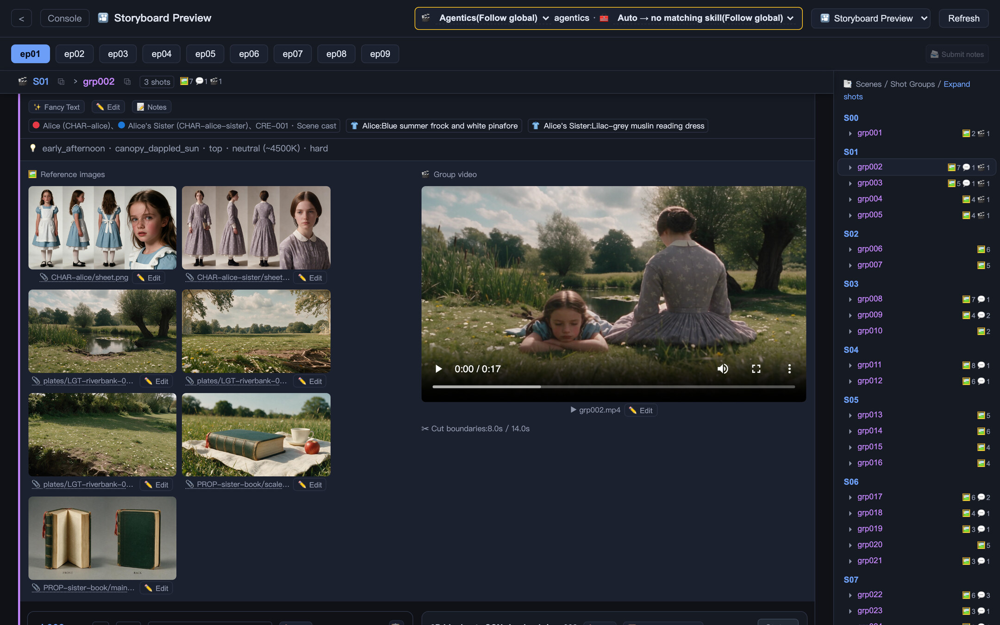
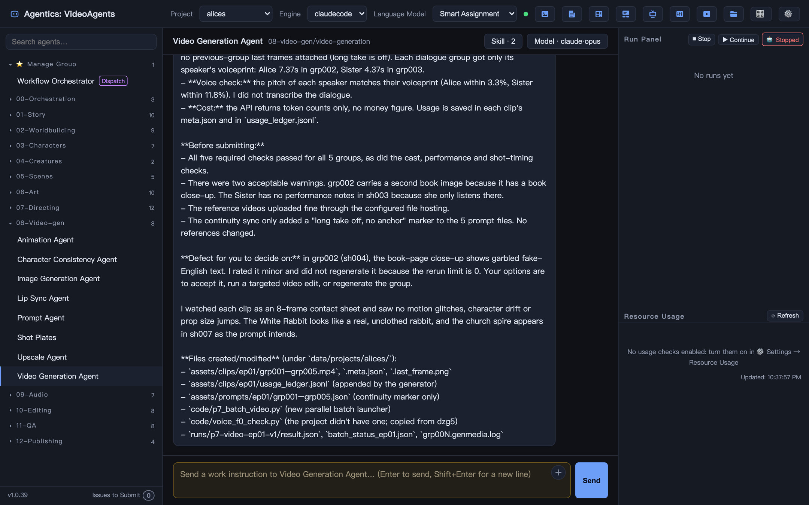
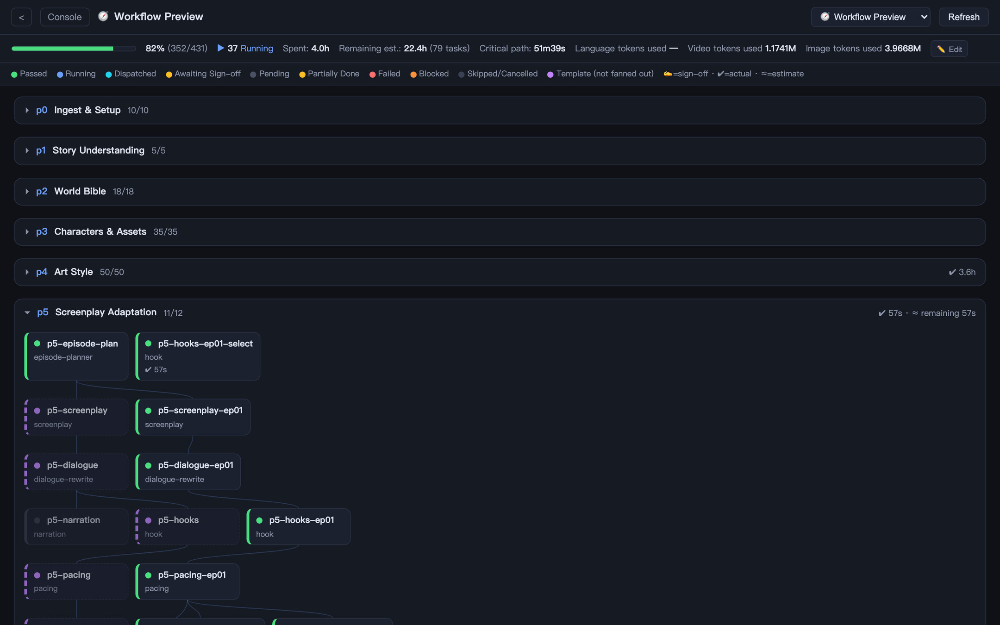
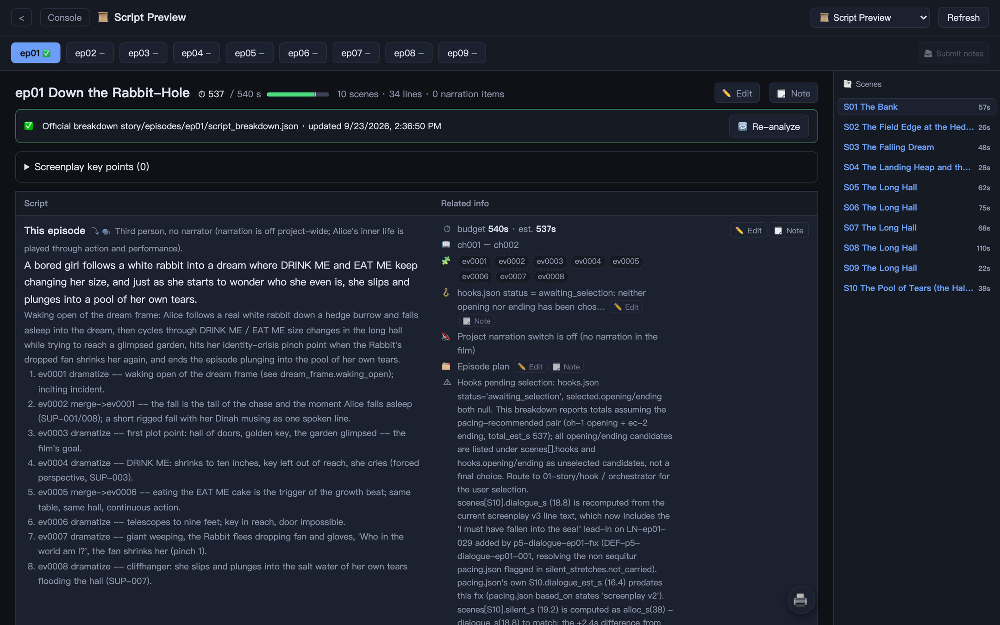
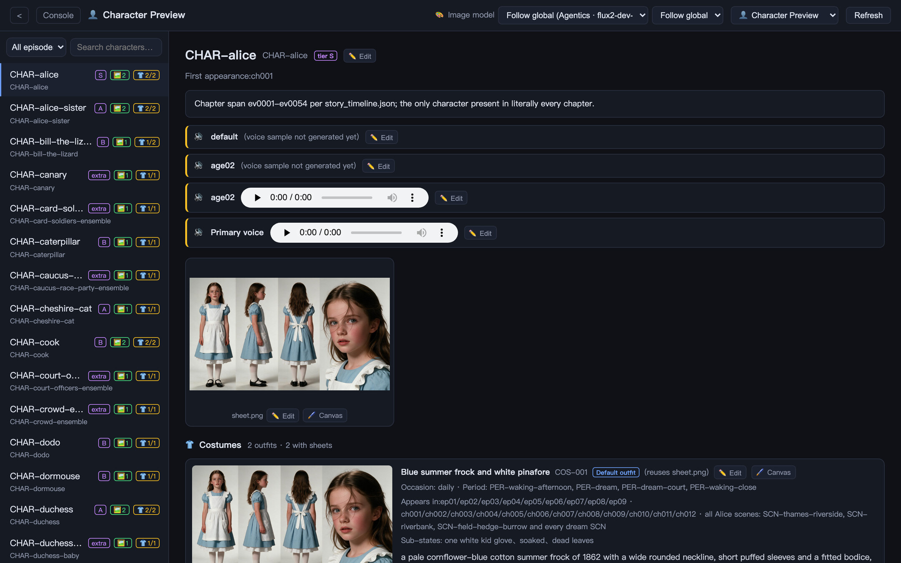
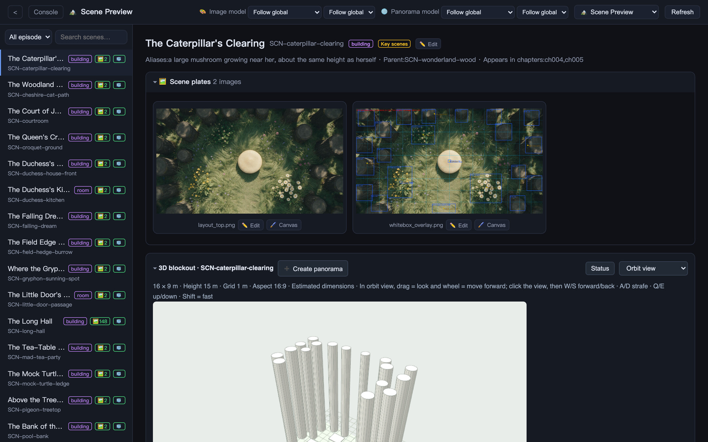
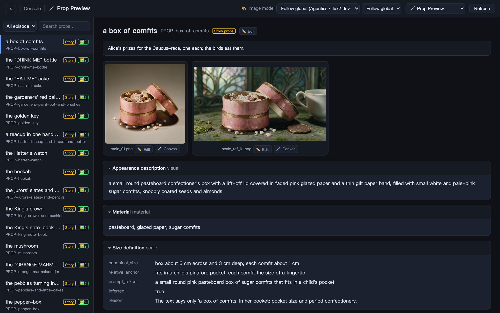
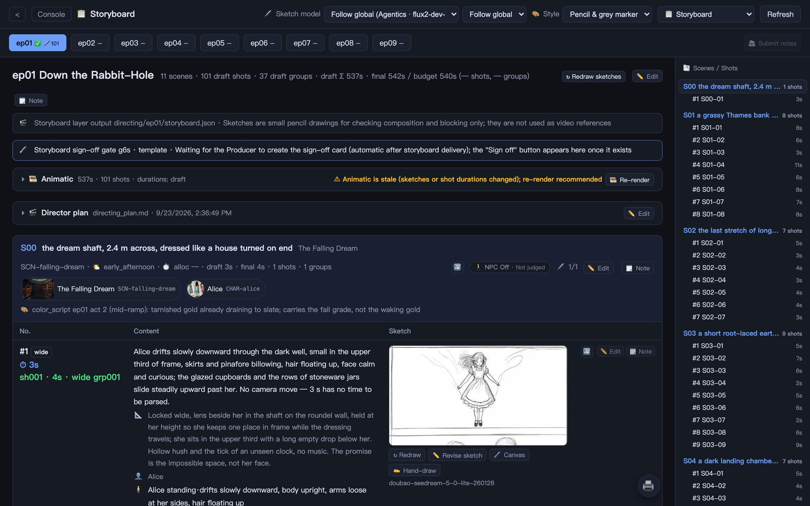
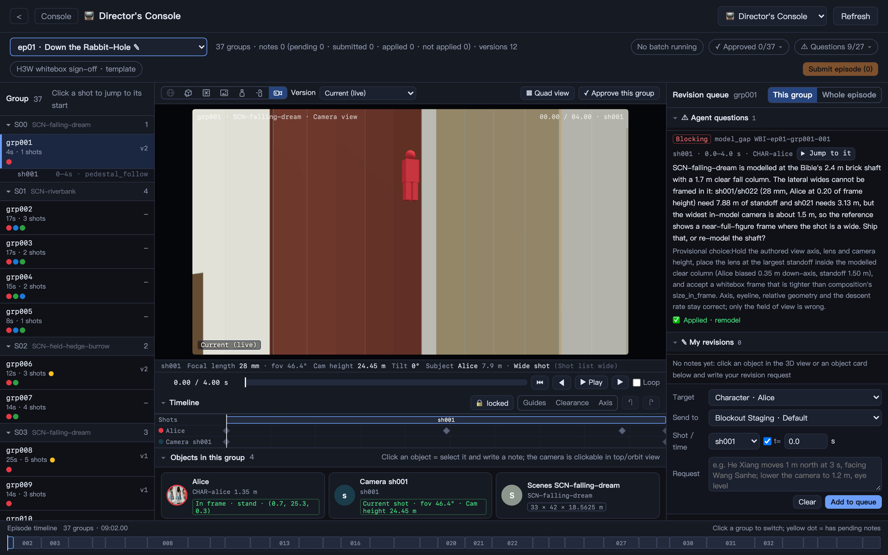
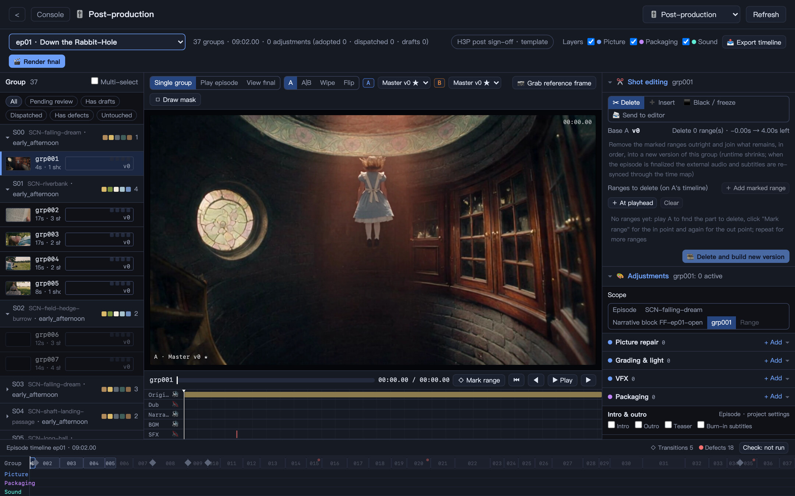

<p align="center">
  
</p>

<h1 align="center">VideoAgents</h1>

<p align="center">
  <strong>人人都能创作视频 —— 全自动智能体团队，成片成本仅约每分钟 3 美元。</strong>
</p>

<p align="center">
  <a href="#quickstart"><strong>快速开始</strong></a> &middot;
  <a href="#works-with"><strong>支持的渠道</strong></a> &middot;
  <a href="https://github.com/AgenticsWorld/VideoAgents-Samples"><strong>示例项目</strong></a> &middot;
  <a href="https://discord.gg/faaZCrWxCq"><strong>Discord</strong></a> &middot;
  <a href="https://x.com/AgenticsWorld"><strong>X</strong></a> &middot;
  <a href="https://shumati.cn/videoagents/"><strong>官网</strong></a> &middot;
  <a href="README.md"><strong>English</strong></a>
</p>

<p align="center">
  <a href="LICENSE"></a>
  <a href="https://github.com/AgenticsWorld/VideoAgents/releases"></a>
  <a href="https://github.com/AgenticsWorld/VideoAgents/stargazers"></a>
  <a href="https://discord.gg/faaZCrWxCq"></a>
</p>

<br/>

<p align="center">
  <a href="docs/assets/readme/storyboard-preview.jpg"></a>
</p>

<p align="center">
  <sub>示例项目 <a href="https://github.com/AgenticsWorld/VideoAgents-Samples">alices</a>（《爱丽丝梦游仙境》）的「分镜预览」页（英文界面）：一个生成组挂的人物定妆图、背景图和道具图，以及它生成出来的视频。</sub>
</p>

<br/>

## 30 秒了解 VideoAgents

<div align="center">
  <video src="https://github.com/user-attachments/assets/97e159f0-8c10-46c2-98d7-915e62d1d749" width="900" controls></video>
</div>

<br/>

# 把小说拍成分集长剧，AI 剧组干活，你来当导演

VideoAgents 是一套开源、文件驱动的多 Agent 视频生产系统，用来把长篇小说改编成分集视频。

**如果说视频模型是一台摄影机，VideoAgents 就是整个制片厂。**

94 个专业 Agent 分属 13 个制作部门——剧情、世界观、角色、生物、场景、美术、导演、视频生成、音频、剪辑、质量审核和发布——按声明式工作流推进，并在人工确认闸门处停下来等你签字，创作方向始终由你决定。系统在你自己的电脑上运行：小说原文、项目文件和生成的媒体都保存在本地工作区。

|        | 步骤           | 做什么                                                                                       |
| ------ | -------------- | -------------------------------------------------------------------------------------------- |
| **01** | 带来一部小说   | 新建项目、导入文本、选定画面风格，设好单集时长和发布平台。                                   |
| **02** | 剧组开工       | 世界圣经 → 角色与资产 → 剧本 → 故事板 → 3D 白模预演 → 视频 → 声音 → 剪辑 → 后期。            |
| **03** | 你来签字       | 从世界圣经到发布最多 12 个确认闸门。上一步没签字，下一步花钱的活就不会开始。                 |

<br/>

<a id="works-with"></a>

## 支持的引擎与渠道

执行引擎和生成渠道都由你自己选。每类生成服务单独配置，不绑定某一个模型或厂商。

|                     | 支持                                                                                                              |
| ------------------- | ----------------------------------------------------------------------------------------------------------------- |
| 🤖 **执行引擎**     | Claude Code · Codex CLI · Kimi Code · Pi · OpenCode · Grok Build · DeepAgents（任意 OpenAI 兼容模型：本地、云端或 OpenRouter） |
| 🖼 **图像**         | Agentics · OpenRouter · 火山引擎 · BytePlus · Fal · RunningHub · ComfyUI                                           |
| 🎬 **视频**         | Agentics · OpenRouter · 火山引擎 · BytePlus · Fal · RunningHub · ComfyUI                                           |
| 🎙 **语音 / TTS**   | Agentics · OpenRouter · 火山引擎 · ElevenLabs · MiniMax · ComfyUI                                                  |
| 🎵 **音乐**         | Agentics · OpenRouter · ElevenLabs · ComfyUI                                                                       |
| 🔊 **音效**         | Openverse · ElevenLabs · Fal                                                                                       |
| 🧑 **数字人**       | Agentics · HeyGen · Kling AI · ComfyUI                                                                             |
| 🔍 **超分**         | FFmpeg · Agentics · 火山引擎 · MiniMax · ComfyUI                                                                   |
| 🌍 **世界模型**     | World Labs                                                                                                         |
| ☁️ **对象存储**     | 火山引擎 TOS · 阿里云 OSS · 腾讯云 COS · 任意 S3 兼容服务                                                          |
| 📣 **发布平台**     | YouTube · Bilibili · TikTok · 抖音 · 小红书                                                                        |
| 📱 **手机消息**     | 微信 · 飞书 · WhatsApp                                                                                             |

<sub>ComfyUI 工作流可在本地、Comfy Cloud 或 RunningHub 上运行。控制台界面支持 12 种语言。</sub>

<br/>

## 如果你符合下面的情况，VideoAgents 适合你

- ✅ 想把**小说或网文拍成多集视频**，但没有一整个剧组
- ✅ 做过一分钟的 AI 短片，到**十分钟级的中长剧**就卡住了：道具服装跳变、人多了镜头失控、反复重抽把预算烧光
- ✅ 希望 Agent **自己把流水线跑下去**，但创作上的决定仍由你确认
- ✅ 想**为每类任务自己选模型**，有更好的模型时随时切换
- ✅ 希望小说原文和生成素材**留在自己的电脑上**
- ✅ 希望每一步都留下**可以打开、修改和追溯的文件**

<br/>

## 功能

<table>
<tr>
<td align="center" width="33%">
<h3>📖 剧情与世界观改编</h3>
把长篇小说拆成事件、时间线和世界圣经，作为后续所有环节的事实依据。
</td>
<td align="center" width="33%">
<h3>🧑‍🎨 角色与资产</h3>
角色、服装、生物、场景、道具各自建卡，配参考图和声音样本，全片每件资产只认一个形象锚点。
</td>
<td align="center" width="33%">
<h3>📜 剧本预览</h3>
剧本与时长、情绪、节奏、钩子分析并排成表，任意一块都能把修改意见直接派给负责的 Agent。
</td>
</tr>
<tr>
<td align="center">
<h3>✏️ 故事板与动态样片</h3>
逐镜分镜表配铅笔草图，可用便宜的图像模型批量出，也可以在手机上手绘，再串成不花生成费的动态样片。
</td>
<td align="center">
<h3>🧊 3D 白模预演</h3>
按米制尺度搭场景，人物、道具和摄影机带关键帧调度。导出的机位白模视频就是视频生成的参考视频。
</td>
<td align="center">
<h3>🎥 导演台</h3>
点选任意人物、道具或机位写修改意见，也可以自己拖动。每次修改自动存版本，可 A|B 对比。
</td>
</tr>
<tr>
<td align="center">
<h3>🎬 图像与视频生成</h3>
提示词按镜头表逐镜写出，每个生成组都带着它必须对齐的定妆图、背景图和道具图。
</td>
<td align="center">
<h3>🎙 配音、音乐与声音</h3>
视频模型原生对白、音色设计与克隆、项目音乐库、音效，以及最终混音。
</td>
<td align="center">
<h3>🎚 后期处理</h3>
调色、修补、特效、包装和声音都按「处方」管理，作用范围从整集到组内时间段，母本永不覆盖。
</td>
</tr>
<tr>
<td align="center">
<h3>🛡 人工确认闸门</h3>
世界圣经、角色与资产、美术风格、剧本、故事板、白模、分镜、视频提示词、视觉生成、后期、首集成片、发布。
</td>
<td align="center">
<h3>✅ 八路质量审核</h3>
逻辑、角色一致性、时间线、世界观一致性、画面、音频、内容安全、版权，八个维度并行审核。
</td>
<td align="center">
<h3>💰 成本控制</h3>
先用不花钱的预演把戏排好，付费步骤排在签字之后，优先复用，草稿分辨率加超分交付，简单任务用便宜模型。
</td>
</tr>
<tr>
<td align="center">
<h3>🔌 插件与技能</h3>
声明式插件扩展新的工位和业务流程，技能教会某个 Agent 一门手艺，两者都可以用 zip 安装。
</td>
<td align="center">
<h3>🗂 全程文件化</h3>
每张设定卡、每条提示词、每份镜头表和审核报告都是项目里的文件，每次生成都记下所用的模型、渠道和参考图。
</td>
<td align="center">
<h3>🏠 本地优先</h3>
在你的电脑上运行，默认只监听 <code>127.0.0.1</code>，并提供版本化 API、OpenAPI 文档和实时事件，便于集成。
</td>
</tr>
</table>

<br/>

## 界面一览

以下截图均为英文界面。

<table>
<tr>
<td align="center" width="33%"><a href="docs/assets/readme/console.jpg"></a><br/><sub><strong>控制台</strong>：Agent 列表、与每个 Agent 的对话、运行面板</sub></td>
<td align="center" width="33%"><a href="docs/assets/readme/workflow.jpg"></a><br/><sub><strong>工作流预览</strong>：流水线 DAG、任务状态、耗时与 token 用量</sub></td>
<td align="center" width="33%"><a href="docs/assets/readme/script.jpg"></a><br/><sub><strong>剧本预览</strong>：剧本分块及对应的时长、事件与钩子</sub></td>
</tr>
<tr>
<td align="center"><a href="docs/assets/readme/characters.jpg"></a><br/><sub><strong>人物预览</strong>：定妆图、音色与服装</sub></td>
<td align="center"><a href="docs/assets/readme/scenes.jpg"></a><br/><sub><strong>场景预览</strong>：俯视布局图、场景图与 3D 白模</sub></td>
<td align="center"><a href="docs/assets/readme/props.jpg"></a><br/><sub><strong>道具预览</strong>：道具卡，含材质与尺寸定义</sub></td>
</tr>
<tr>
<td align="center"><a href="docs/assets/readme/storyboard.jpg"></a><br/><sub><strong>故事板</strong>：分镜表、铅笔草图与动态样片</sub></td>
<td align="center"><a href="docs/assets/readme/director.jpg"></a><br/><sub><strong>导演台</strong>：在 3D 白模现场里做调度</sub></td>
<td align="center"><a href="docs/assets/readme/post.jpg"></a><br/><sub><strong>后期处理</strong>：A|B 监视器、处方与整集时间轴</sub></td>
</tr>
</table>

<br/>

## VideoAgents 解决什么问题

| 没有 VideoAgents | 有了 VideoAgents |
| --- | --- |
| ❌ 上一镜桌上的杯子是青花瓷，下一镜变成了白瓷；主角上一场穿的孝服，下一场又换回了干净的常服。 | ✅ 全片资产库：道具卡、按「场合 × 时期」排的服装矩阵，以及每个生成组都要对齐的参考图。 |
| ❌ 一两个人在画面里还好控制。人一多、镜头一长，谁站在哪、看向哪、走到哪，靠文字说不清。 | ✅ 按米制尺度做 3D 白模预演：人物、道具和摄影机带关键帧调度，审看后导出机位白模视频，作为参考视频挂进生成指令。 |
| ❌ 把「这场戏的张力」翻译成模型能执行的指令，靠人工逐镜手搓，慢而且不稳定。 | ✅ Prompt Agent 逐镜按「运镜、动作与表情、空间位置、音频」写提示词：一镜只用一种运镜，动作写明幅度和速度，情绪写成看得见的身体细节。 |
| ❌ 角色长相跑偏，不在场的人也被画进画面。 | ✅ 新生成的关键帧与定妆图做人脸相似度比对；提示词带身份锁，画面里的每个人都必须对得上一张参考图。 |
| ❌ 片子都生成完了，才发现剧本或分镜不对。 | ✅ 把审看前移到不花钱的环节：剧本预览、故事板草图和动态样片。上游在签字之后又被改动时，页面会标记签字已过期。 |
| ❌ 预算大多花在最后用不上的废片上：反复重抽、高分辨率直出、每一镜都重新出参考图。 | ✅ 先做不花钱的预演，付费步骤排在签字之后，优先复用，草稿分辨率加超分交付，自动重跑默认关闭：成片成本约每分钟 3 美元。 |
| ❌ 成片里有一处瑕疵，只能整组重抽。 | ✅ 后期处理工作台：调色、修补、特效和声音都是带版本的处方，可 A\|B 对比、随时回滚。 |
| ❌ 换脸有肖像权风险，还容易做出每部剧都一样的「平均脸」。 | ✅ 角色是按文字设定和美术风格生成的原创形象，不拿真人照片做换脸。 |
| ❌ 平台审查看得很细，一项素材拿不出授权就可能下架。 | ✅ 内容安全 Agent 和版权 Agent 在发布前逐集审查：镜头、封面、字幕、配乐和字体。 |
| ❌ 说不清某一版角色或镜头是怎么来的。 | ✅ 每一步都落成项目里的文件，每个生成物都记下所用的模型、渠道和参考图。 |

<br/>

<a id="quickstart"></a>

## 快速开始

开源，本地运行，执行引擎和生成渠道用你自己的账号。

### 直接安装桌面客户端

| 平台                    | 下载                                                                                  |
| ----------------------- | ------------------------------------------------------------------------------------- |
| macOS（Apple 芯片）     | [VideoAgents.zip](https://cdn.shumati.cn/packages/video-agents/mac/VideoAgents.zip)   |
| Windows（x64）          | [VideoAgents.zip](https://cdn.shumati.cn/packages/video-agents/win/VideoAgents.zip)   |

1. **下载、解压、打开。** 安装包不含 Python，首次启动时客户端会自动下载运行环境。
2. **在顶栏选一个执行引擎。** 对应的命令行没装或没登录时会弹出引导窗口：用官方脚本一键安装，再弹出终端运行它自己的登录命令。
3. **配置生成渠道。** 在 ⚙️ 设置 → 生成模型 里填入要用的图像、视频、音频服务的凭据。
4. **新建项目并导入小说。** 剧组从世界圣经开始干活，每到一个确认闸门就停下来等你签字。

媒体检查、音频处理和剪辑需要 FFmpeg。Windows 客户端在本机没有 FFmpeg 时会提示自动下载；macOS 用 `brew install ffmpeg` 安装。

### 或者从源码运行

环境要求：Python 3.10 或更高版本、FFmpeg、至少一种执行引擎。Node.js 22.12 或更高版本只在开发或打包桌面客户端时需要。

```bash
git clone https://github.com/AgenticsWorld/VideoAgents.git
cd VideoAgents
python3 -m venv .venv
source .venv/bin/activate
python -m pip install --upgrade pip
python -m pip install -e .
python apps/web/check.py
python apps/web/server.py
```

浏览器打开 <http://127.0.0.1:8630>，API 文档位于 <http://127.0.0.1:8630/api/v1/docs>。完成可编辑安装后也可以直接运行 `videoagents-web`；只需要 API 服务时运行 `videoagents-api`。

需要无人值守的全自动流水线时，用 `make run-auto` 启动，`claude` 引擎的 Agent 执行命令时不再弹审批。该模式下 Agent 可以执行任意命令，请只在可信的机器上使用。

桌面端开发、打包、发版和 DeepAgents 调参见 [`docs/DEVELOPMENT.zh-CN.md`](docs/DEVELOPMENT.zh-CN.md)。

<br/>

## 更多

- **插件** — [VideoAgents-Plugins](https://github.com/AgenticsWorld/VideoAgents-Plugins)：扩展剧组的 Agent 团队与流程，如衍生小说、双书融合、音频配画、混剪配画、有声剧、数字人对话。在 ⚙️ 设置 → 插件 里上传 zip 安装，上传的插件保存在可写的运行时数据目录。
- **技能** — [VideoAgents-Skills](https://github.com/AgenticsWorld/VideoAgents-Skills)：教某个 Agent 一门手艺的 `SKILL.md` 技能包。在控制台的「技能」按钮里上传 zip 安装。
- **示例项目** — [VideoAgents-Samples](https://github.com/AgenticsWorld/VideoAgents-Samples)：可以直接打开看的完整项目，包括本页截图用的 _alices_。在项目下拉里用「导入项目…」导入 zip。

<br/>

## 仓库结构

```text
agents/           Agent 职责、工作流文档和 DAG
code/             仓库级校验与工具脚本
modules/          媒体、音频和 DeepAgents 适配器
services/api/     可独立运行的 Python API 服务、Schema 和运行状态
services/runtime/ Agent 调度、项目业务、Provider 与内部运行工具
apps/web/         原 WebUI 静态页面、Python 静态服务与同源 API 反向代理
apps/desktop/     Electron 外壳、Python Web 服务生命周期、打包与更新
plugins/          声明式 Agent 插件（仓库内置衍生小说团队）
tests/            回归测试（pytest）：模块、流水线 CLI 与仓库完整性
data/projects/    视频项目资源、输入与生成产物，默认不入 Git
```

`agents/WORKFLOW.md` 是供人阅读的流程权威，`agents/workflow.yaml` 是 orchestrator 的机器执行输入。浏览器与 Electron 共用同一套静态 WebUI，旁边是版本化的 `/api/v1`、OpenAPI、持久运行状态与实时 SSE 通知。完整的组件关系和目录决策见 [`docs/ARCHITECTURE.md`](docs/ARCHITECTURE.md)。

<br/>

## 配置与安全

运行配置和 SQLite 控制状态保存在 `data/.videoagents/`，项目素材始终保存在 `data/projects/`。这些目录可能包含 API Key、运行日志、小说原文和生成媒体，均不会入库。

公开版默认：

- 仅监听 `127.0.0.1`
- Agent 权限模式为 `acceptEdits`
- 不读取 Claude OAuth 凭据进行用量探测

需要局域网手绘分镜或更高自动化权限时，参考 [`.env.example`](.env.example) 显式开启。启用前请阅读 [`SECURITY.md`](SECURITY.md)，不要把控制台直接暴露到公网。

<br/>

## 开发

```bash
python -m pip install -e ".[dev]"
pytest
npm run test:web   # 浏览器端白模 / 导演台代码的 Node 检查
```

CI 跑 `tests/` 全量：模块与流水线 CLI 回归、仓库完整性（JSON/YAML、工作流 Agent 引用、安全默认值）、HTTP 层（路由表、离线 GET 冒烟、Web 控制台页面）。需要 `ffmpeg` 的用例在未安装时自动跳过。

完整的开发指南见 [`docs/DEVELOPMENT.zh-CN.md`](docs/DEVELOPMENT.zh-CN.md)，参与贡献见 [`CONTRIBUTING.md`](CONTRIBUTING.md)。

<br/>

## 社区

- [Discord](https://discord.gg/faaZCrWxCq) — 加入社群
- [X](https://x.com/AgenticsWorld) — 关注更新与公告
- [GitHub Issues](https://github.com/AgenticsWorld/VideoAgents/issues) — 报告问题、提功能建议

<br/>

## 许可证

Copyright 2026 AgenticsWorld.

项目采用 [GNU 通用公共许可证第 3 版](LICENSE)（`GPL-3.0-only`）。允许使用、修改、分发和商业使用；分发本项目或其修改版时，必须以同一许可证发布并提供对应的源代码，保留许可证与版权声明（含 [`NOTICE`](NOTICE)），并标明所做修改及修改日期。本软件不附带任何担保。

v1.0.38 及更早的发布版本以 Apache License 2.0 发布，这些版本仍可按该许可证使用。

标准引用信息见 [`CITATION.cff`](CITATION.cff)。

## 商标与服务

文中出现的第三方产品和渠道名称只用于说明可对接的集成，商标和服务权利归各自所有者。VideoAgents 不提供也不再分发任何第三方模型或服务。

<br/>

---

<p align="center">
  <sub>以 GPL-3.0 开源。给想当导演、不想整天盯着模型抽卡的人。</sub>
</p>
